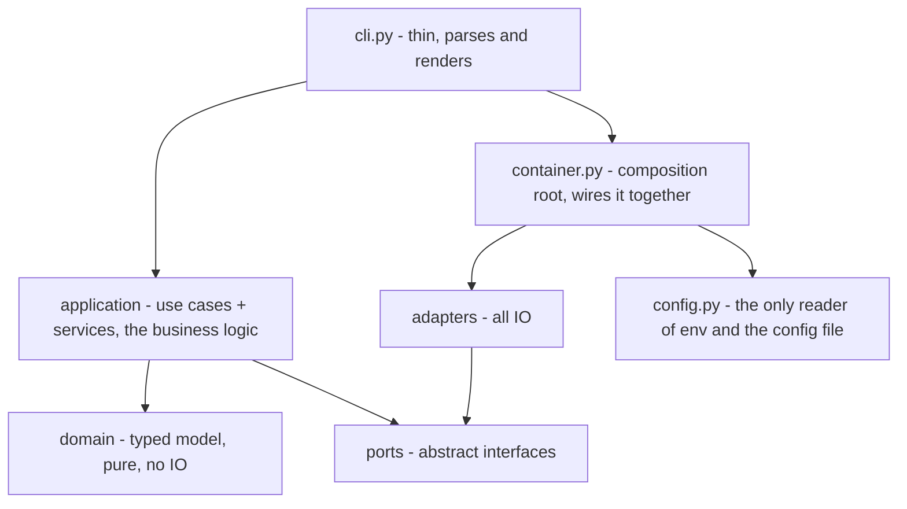
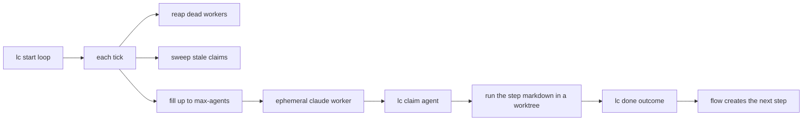

# Architecture

lightcycle is a workflow-agnostic engine: a CLI (`lc`) over a pipeline of ephemeral agents. It is built hexagonal (ports and adapters) - dependencies point inward, and the domain depends on nothing.

## Layers

- **domain/** - entities (`Item`, `Step`, `Pass`, `PhaseRun`) and value objects (`State`, `Park`), plus pure logic: state roll-up, lane derivation, artifact contracts, flow assembly, retro signals. Stdlib only, no IO, no ambient time/uuid/random. Millisecond unit tests.
- **ports/** - the interfaces the application depends on: `StorePort`, `GitPort`, `FsPort`, `WorkflowBundlePort`, `WorkerLogPort`, `ScaffoldPort`, `WorkersPort`, `SpawnerPort`, `RunLockPort`, `MachinePort`.
- **application/** - one use case per action, grouped by activity (inspect, work, flow, pool, feedback, setup), plus services (`FlowService`, `WorktreeService`). Depends on ports, not adapters.
- **adapters/** - all IO: `SqliteStore`, git, the worker spawner, the workers registry, the filesystem, the run-lock. The only callers of `sqlite3` / `git` / `subprocess`.
- **config.py / container.py** - the environment boundary and the composition root. `config.py` stays the only reader of the environment and the config file; its pure concerns live in `config_seeds.py` (what `lc init` writes), `config_ranges.py` (numeric validation), `config_schedules.py` (`schedule-*` and `workflow-*` blocks) and `config_reload.py` (reload outcomes and the restart-required set), which take their inputs as arguments. `Container` also wires `tick()`, `stop_pool()` and `simulation()` (a context manager that owns the simulate scratch directory).
- **commands/** - the `cmd_*` functions, one module per command group (`inspect`, `intake`, `flow`, `pool`, `feedback`, `setup`, `workflow`) beside the use cases they drive, with `context.py` holding the container binding. `cli.py` keeps `main`, the worker-permission gate, the parser wiring and the loop commands, and re-imports every `cmd_*` so dispatch is unchanged.
- **adapters/sqlite/** - `SqliteStore` inherits one mixin per aggregate (`items`, `steps`, `runs`, `usage`, `feedback`, `projects`); `sqlite_store.py` keeps the connection, `transaction()`, schema, migrations, id minting and row mappers.
- **adapters/tui/** - `hub.py` holds `NodeHubScreen`; `hub_render.py` (pure text and cell builders), `hub_widgets.py`, `artifact_viewer.py` and `hub_tabs/<tab>.py` (one mixin per tab) hold the rest. `app.py` holds `LightcycleApp`; each tab view lives in `views/<view>.py` with the shared tables in `adapters/tui/views/tables.py`, and the modals in `modals.py`.

`RouteStepService` (`application/flow/route_step.py`) is how a step is routed to a role: park, unblock and repin call it inside their transaction, and the store has no `reassign`. `TickUseCase` takes an injected `SweepUseCase` and two gate groupings: `CadenceGatesUseCase` (schedule, lifecycle and script gates) and `AccrualGatesUseCase` (usage then gh-call accrual).

The engine ships **zero runtime dependencies** (stdlib only). Dev/test tooling (`uv`, `pytest`) is separate and never imported by `lightcycle/`.

## The pool

`lc start` is a single long-lived loop. Each tick it reaps dead workers, sweeps stale claims, checks open PRs (answered from the in-memory **pr snapshot**, which the **github poll** fills every `github-poll-seconds` on a background thread, so a tick never waits on GitHub), then fills up to `max-agents` workers from the ready queue, leaving out steps whose stage is `github: heavy` while the **github budget** is below `github-reserve-calls`. A worker is an **ephemeral claude process** that claims exactly one step, runs it, and exits.

`lc stop --drain` asks the pool to drain instead of stopping outright. It writes a `.lc-drain` marker beside the run lock (`PoolDrainPort`), which the loop reads once per tick. While the marker is set the tick spawns no worker, but everything else still runs: reaping, the sweep, the PR monitor, the cadence gates and hook completions, so finished work closes and a step a finishing worker creates is filed and left queued. The pool exits the first tick that reports no alive worker (booting workers included) and no in-flight engine step (a `role: engine` step still queued or running, such as a `poll-ci` watching CI), running the same shutdown a plain stop runs. Human gates and not-yet-started agent steps are never waited on. A drain older than `DRAIN_SLOW_SECONDS` (30 minutes, measured from the marker's mtime) says `slow` in the footer, `lc status` and the run log; it never exits on its own. A plain `lc stop` or Ctrl-C during a drain overrides it and stops immediately. `lc start` clears the marker when it takes the run lock and again on exit, so a marker left by a crashed pool never drains the next one.

The first SIGTERM or SIGINT only sets a **stop request** (`StopSignal`); the loop checks it between ticks, so a tick and the completions it applies are never cut off, and a second Ctrl-C still forces. Script stages run in their own process group, so signalling the pool no longer reaches them: shutdown asks `RunGroupsPort` to SIGTERM each group, wait the shutdown grace, then SIGKILL it, and a timeout kills the whole group. Each running script is recorded in `script-runs/` so a restarted pool does not start a second copy.

A worker's system prompt is the step body plus, when guidance entries match, one `## Guidance for this project` section appended after it. The engine selects the stable entries from the guidance repo whose facets are all declared by the item's project and whose steps name the claimed step, fills them within `guidance-budget-bytes`, and records the ids delivered and skipped on the step as the internal artifacts `guidance-delivered` and `guidance-skipped`, shown by `lc show` as `guidance_delivered` and `guidance_skipped`. The section ends with an engine-written instruction naming the step's own id: when an entry changed what the worker did, it cites it once with `lc attach <step-id> guidance-cited "<id>[, <id>...]"`. The engine records the citation as an internal `guidance-cited` artifact, and refuses an id that was not delivered to that step and a second citation on the same step. `lc show <step>` lists every artifact stored against the step, internal ones included, under `artifacts`. A missing guidance repo or a malformed entry never blocks a spawn: it is written to the worker log and reported by `lc doctor` under `guidance`.

### Workflow lifecycle hooks

A workflow may declare `install`, `upgrade` and `maintain` scripts (and a `cron` for `maintain`) in a `lifecycle:` front-matter block. The pin carries the bundle's `scripts/` tree with the executable bit preserved. `LifecycleRunnerPort` is the only place a hook is spawned: it runs the script directly (no shell) in `<data_root>/workflow-data/<origin>/<workflow>/` with stdin closed, stdout and stderr merged and `lifecycle-timeout-seconds` as the timeout. The environment is the engine's `agent_env()` plus `LC_WORKFLOW_HOOK`, `LC_WORKFLOW_ORIGIN`, `LC_WORKFLOW_NAME`, `LC_WORKFLOW_DATA_DIR`, `LC_WORKFLOW_BUNDLE_DIR`, `LC_WORKFLOW_SHA`, `LC_WORKFLOW_FROM_SHA`/`LC_WORKFLOW_TO_SHA` (upgrade only) and one `LC_WORKFLOW_CONFIG_<KEY>` per declared, non-blank key of the `workflow-<origin>-<name>` config block.

`lc workflow add` and `lc workflow upgrade` run `install`/`upgrade` before the registry is written, so a failing hook leaves the origin unregistered or at its previous SHA. `maintain` runs only from the pool tick: `LifecycleCadenceUseCase` starts it on a background thread when `previous_due(cron, now)` is later than the due time recorded in `<data_root>/lifecycle-state.json`, reaps it on a later tick, and files one `review-lifecycle-failure` inbox item on a non-zero exit or timeout (none while one is open for that workflow). `lc workflow check` validates the block; `lc workflow simulate` runs the three hooks in a scratch data directory with the `config-example` values.

### Workflow script stages and script guards

A step file may name `script: scripts/<file>`; the stage is then engine-owned and `ScriptStageUseCase` (a tick gate) runs the script through `ScriptRunnerPort`, the only place these scripts are spawned (a separate port and adapter from `LifecycleRunnerPort`, so the maintain gate never reaps them). The tick reaps finished runs first, then starts queued script steps up to `script-max-running`; the step stays `QUEUED` while the script runs, which is why `PoolDrainStatusUseCase` and `_drain_complete` need no change. A `schedule:` block may name `guard: script:scripts/<file>`; `ScheduleCadenceUseCase` starts it in the background, records the due time as evaluated and files the item when the run is reaped.

The script runs directly (no shell) with a timeout of `script-timeout-seconds`, stderr kept apart from stdout. The contract is documented as **script contract** in `docs/ontology.md`: environment variables for ids and config, one JSON object on stdin, one JSON object on stdout. A violation parks a stage step through `ParkStepUseCase` and makes a guard warn once per reason.

`lc workflow check` validates every `script:` path (under `scripts/`, no `..`, existing, executable), the stage's declared outcomes and a fixture for each script; `--dir` runs the same script-stage checks. A fixture is `scripts/fixtures/<script path after scripts/>.json`, an object keyed by outcome whose values are the exact objects the script would print (a guard's keys are `pass` and `fail`). `lc workflow simulate` never runs a script: it completes each script stage with its fixture entry for the planned outcome and parses each script guard's fixtures. A bundle keeps its script tests in `scripts/tests/` and runs them in its own CI; neither `check` nor `simulate` runs them, and files under `scripts/tests/` and `scripts/fixtures/` are not scripts.

## Seams a change can break

Each seam below is a place where the engine relies on a timing, ordering or ownership assumption that no type or signature states. A change that touches one should say which assumption it keeps or alters. Terms are defined in [ontology.md](ontology.md); this section only names where each assumption is enforced today.

- **The pool tick.** `TickUseCase.execute` in `lightcycle/application/pool/tick.py` runs the gates in a fixed order: config reload, worker reap, interrupted-run release, the PR monitor, the **github poll**, the cadence gates (schedules, lifecycle, script stages), the breaker, backup, guidance sync, accrual, the sweep, then the spawn plan and hook completions. A later gate may rely on an earlier one having run in the same tick, so reordering is a behaviour change. The loop in `lightcycle/cli.py` checks the `StopSignal` (`lightcycle/adapters/stop_signal.py`) only between ticks, so a signal never cuts a tick short. A tick that raises is counted by `_advance_tick_state`, and `_tick_failure_action` re-raises once `tick-failure-cap` consecutive failures are reached. Each completion a gate applies goes through `CompleteStepUseCase` in `lightcycle/application/flow/complete_step.py`, which closes the step and files its successor in one `complete_step_atomic` store call, so a reader never sees a closed step without its successor; the pool gates that close several records together (`lightcycle/application/pool/resolve_merged_prs.py`, `lightcycle/application/pool/schedule_cadence.py`) wrap them in `store.transaction()`.
- **Step ownership.** A step belongs to exactly one of three kinds of owner. An **agent** step is claimed by a worker through `ClaimStepUseCase` (`lightcycle/application/flow/claim_step.py`), one step per spawn id. A **script** or other **engine** step is never claimed: `ScriptStageUseCase` in `lightcycle/application/pool/script_stages.py` starts a `queued` engine step and leaves it `QUEUED` while the script runs, so the queue and drain checks that count queued engine steps keep seeing it as live work. A **human** step is created in, or routed to, `waiting` and only a person moves it. Code that assumes "running means a worker holds it" is wrong for script stages.
- **Phase runs and rounds.** A phase run owns one branch and one PR per `(item, pass, phase, round)`, built by `lightcycle/domain/runs/phase_run.py`. Re-entering a phase whose run closed opens the next round with a new branch and worktree; a closed run is never re-opened. A pass end runs `PassBook.release_refusals` (`lightcycle/application/flow/passes.py`) before anything is released, and a merged PR is released by `lightcycle/application/pool/resolve_merged_prs.py` after its close transaction commits. The gap between the commit and the release is the **interrupted release**, finished by `lightcycle/application/pool/release_interrupted_runs.py` on a pool's first tick.
- **GitHub timing.** GitHub is read only by the background poll, so the tick sees the **pr snapshot** (`lightcycle/application/pool/pr_snapshot.py`) and never GitHub itself. Check runs register some time after a push, so an empty check set for a new head is not a verdict: `lightcycle/application/pool/resolve_ci.py` holds `poll-ci` until `confirmed_after` reports that a poll starting after it first saw the step has confirmed the PR's view, and applies the start window and check ceiling from config. The call budget is read once per poll and gated by `GithubBudgetUseCase` (`lightcycle/application/pool/github_budget.py`), which withholds `github: heavy` steps below `github-reserve-calls`.
- **Shutdown and restart.** `StopPoolUseCase` (`lightcycle/application/pool/stop_pool.py`) stops workers, reclaims their steps and asks `RunGroupsPort` (`lightcycle/adapters/run_groups.py`) to SIGTERM each script process group, wait the grace period, then SIGKILL it. `ScriptRunnerAdapter` (`lightcycle/adapters/script_runner.py`) records each live script in `script-runs/`. A restarted pool's `orphaned()` keeps a record whose process is still alive, counts it against `script-max-running` and does not start a second copy; a record whose process is gone is deleted, and the step, still `QUEUED`, runs again. The sweep (`lightcycle/application/pool/sweep.py`) reclaims claims whose worker is gone or stalled, so a script must tolerate being re-run from the start.
- **Worktrees.** A worktree is created by `WorktreeService.ensure` (`lightcycle/application/services/worktree.py`), either at claim time for an agent step or by a script stage whose workflow declares a workspace. It is removed only through the teardown guard: `teardown_refusals`, `pass_release_refusals` and `phase_release_refusals` in the same file refuse while a worktree has uncommitted paths or a branch holds unmerged commits, and `release_run` is the one removal path. Deleting a worktree any other way strands the branch and the run record that names it.

## Agnostic by construction

The engine and `lc` know nothing about a specific workflow. The stages (`write-code`, `review-code`, `open-pr`, ...) and their artifact contracts live in a **workflow source** - `workflows/*.md` + `steps/*.md` in a pullable git origin - composed from generic primitives (`lc new`, `lc attach`, `lc done`, `lc dep`). Point lightcycle at a different workflow - a frontend repo, a data pipeline - by authoring or pulling a different source, not by editing the code. See [installation-and-config.md](installation-and-config.md) for workflow sources.
