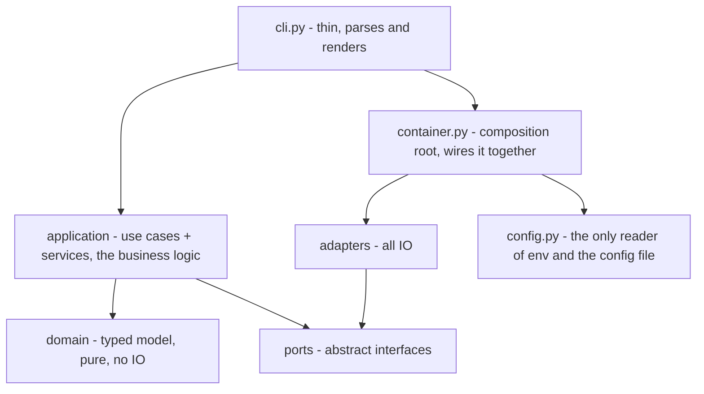
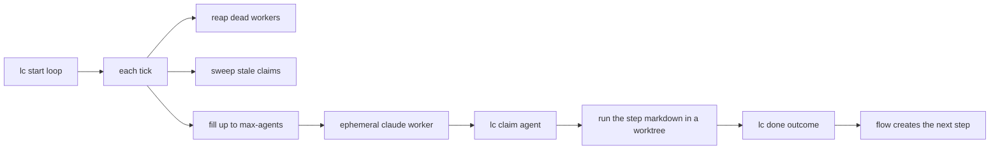

# Architecture

lightcycle is a workflow-agnostic engine: a CLI (`lc`) over a pipeline of ephemeral agents. It is built hexagonal (ports and adapters) - dependencies point inward, and the domain depends on nothing.

## Layers

- **domain/** - entities (`Item`, `Step`, `Pass`, `PhaseRun`) and value objects (`State`, `Park`), plus pure logic: state roll-up, lane derivation, artifact contracts, flow assembly, retro signals. Stdlib only, no IO, no ambient time/uuid/random. Millisecond unit tests.
- **ports/** - the interfaces the application depends on: `StorePort`, `GitPort`, `FsPort`, `WorkflowBundlePort`, `WorkerLogPort`, `ScaffoldPort`, `WorkersPort`, `SpawnerPort`, `RunLockPort`, `MachinePort`.
- **application/** - one use case per action, grouped by activity (inspect, work, flow, pool, feedback, setup), plus services (`FlowService`, `WorktreeService`). Depends on ports, not adapters.
- **adapters/** - all IO: `SqliteStore`, git, the worker spawner, the workers registry, the filesystem, the run-lock. The only callers of `sqlite3` / `git` / `subprocess`.
- **config.py / container.py** - the environment boundary and the composition root.

The engine ships **zero runtime dependencies** (stdlib only). Dev/test tooling (`uv`, `pytest`) is separate and never imported by `lightcycle/`.

## The pool

`lc start` is a single long-lived loop. Each tick it reaps dead workers, sweeps stale claims, checks open PRs (answered from the in-memory **pr snapshot**, which the **github poll** fills every `github-poll-seconds` on a background thread, so a tick never waits on GitHub), then fills up to `max-agents` workers from the ready queue. A worker is an **ephemeral claude process** that claims exactly one step, runs it, and exits.

`lc stop --drain` asks the pool to drain instead of stopping outright. It writes a `.lc-drain` marker beside the run lock (`PoolDrainPort`), which the loop reads once per tick. While the marker is set the tick spawns no worker, but everything else still runs: reaping, the sweep, the PR monitor, the cadence gates and hook completions, so finished work closes and a step a finishing worker creates is filed and left queued. The pool exits the first tick that reports no alive worker (booting workers included) and no in-flight engine step (a `role: engine` step still queued or running, such as a `poll-ci` watching CI), running the same shutdown a plain stop runs. Human gates and not-yet-started agent steps are never waited on. A drain older than `DRAIN_SLOW_SECONDS` (30 minutes, measured from the marker's mtime) says `slow` in the footer, `lc status` and the run log; it never exits on its own. A plain `lc stop` or Ctrl-C during a drain overrides it and stops immediately. `lc start` clears the marker when it takes the run lock and again on exit, so a marker left by a crashed pool never drains the next one.

A worker's system prompt is the step body plus, when guidance entries match, one `## Guidance for this project` section appended after it. The engine selects the stable entries from the guidance repo whose facets are all declared by the item's project and whose steps name the claimed step, fills them within `guidance-budget-bytes`, and records the ids delivered and skipped on the step as the internal artifacts `guidance-delivered` and `guidance-skipped`, shown by `lc show` as `guidance_delivered` and `guidance_skipped`. The section ends with an engine-written instruction naming the step's own id: when an entry changed what the worker did, it cites it once with `lc attach <step-id> guidance-cited "<id>[, <id>...]"`. The engine records the citation as an internal `guidance-cited` artifact, and refuses an id that was not delivered to that step and a second citation on the same step. `lc show <step>` lists every artifact stored against the step, internal ones included, under `artifacts`. A missing guidance repo or a malformed entry never blocks a spawn: it is written to the worker log and reported by `lc doctor` under `guidance`.

### Workflow lifecycle hooks

A workflow may declare `install`, `upgrade` and `maintain` scripts (and a `cron` for `maintain`) in a `lifecycle:` front-matter block. The pin carries the bundle's `scripts/` tree with the executable bit preserved. `LifecycleRunnerPort` is the only place a hook is spawned: it runs the script directly (no shell) in `<data_root>/workflow-data/<origin>/<workflow>/` with stdin closed, stdout and stderr merged and `lifecycle-timeout-seconds` as the timeout. The environment is the engine's `agent_env()` plus `LC_WORKFLOW_HOOK`, `LC_WORKFLOW_ORIGIN`, `LC_WORKFLOW_NAME`, `LC_WORKFLOW_DATA_DIR`, `LC_WORKFLOW_BUNDLE_DIR`, `LC_WORKFLOW_SHA`, `LC_WORKFLOW_FROM_SHA`/`LC_WORKFLOW_TO_SHA` (upgrade only) and one `LC_WORKFLOW_CONFIG_<KEY>` per declared, non-blank key of the `workflow-<origin>-<name>` config block.

`lc workflow add` and `lc workflow upgrade` run `install`/`upgrade` before the registry is written, so a failing hook leaves the origin unregistered or at its previous SHA. `maintain` runs only from the pool tick: `LifecycleCadenceUseCase` starts it on a background thread when `previous_due(cron, now)` is later than the due time recorded in `<data_root>/lifecycle-state.json`, reaps it on a later tick, and files one `review-lifecycle-failure` inbox item on a non-zero exit or timeout (none while one is open for that workflow). `lc workflow check` validates the block; `lc workflow simulate` runs the three hooks in a scratch data directory with the `config-example` values.

### Workflow script stages and script guards

A step file may name `script: scripts/<file>`; the stage is then engine-owned and `ScriptStageUseCase` (a tick gate) runs the script through `ScriptRunnerPort`, the only place these scripts are spawned (a separate port and adapter from `LifecycleRunnerPort`, so the maintain gate never reaps them). The tick reaps finished runs first, then starts queued script steps up to `script-max-running`; the step stays `QUEUED` while the script runs, which is why `PoolDrainStatusUseCase` and `_drain_complete` need no change. A `schedule:` block may name `guard: script:scripts/<file>`; `ScheduleCadenceUseCase` starts it in the background, records the due time as evaluated and files the item when the run is reaped.

The script runs directly (no shell) with a timeout of `script-timeout-seconds`, stderr kept apart from stdout. The contract is documented as **script contract** in `docs/ontology.md`: environment variables for ids and config, one JSON object on stdin, one JSON object on stdout. A violation parks a stage step through `ParkStepUseCase` and makes a guard warn once per reason.

`lc workflow check` validates every `script:` path (under `scripts/`, no `..`, existing, executable), the stage's declared outcomes and a fixture for each script. A fixture is `scripts/fixtures/<script path after scripts/>.json`, an object keyed by outcome whose values are the exact objects the script would print (a guard's keys are `pass` and `fail`). `lc workflow simulate` never runs a script: it completes each script stage with its fixture entry for the planned outcome and parses each script guard's fixtures. A bundle keeps its script tests in `scripts/tests/` and runs them in its own CI; neither `check` nor `simulate` runs them, and files under `scripts/tests/` and `scripts/fixtures/` are not scripts.

## Agnostic by construction

The engine and `lc` know nothing about a specific workflow. The stages (`write-code`, `review-code`, `open-pr`, ...) and their artifact contracts live in a **workflow source** - `workflows/*.md` + `steps/*.md` in a pullable git origin - composed from generic primitives (`lc new`, `lc attach`, `lc done`, `lc dep`). Point lightcycle at a different workflow - a frontend repo, a data pipeline - by authoring or pulling a different source, not by editing the code. See [installation-and-config.md](installation-and-config.md) for workflow sources.
