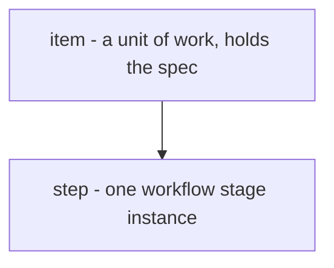
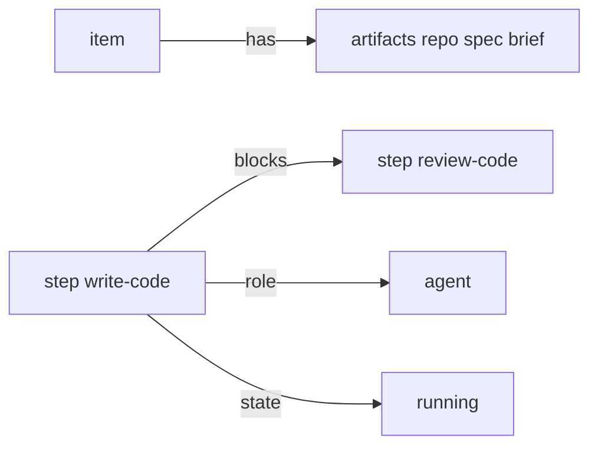

# Data model

lightcycle tracks work as **items** and **steps**, in two SQLite tables (`items`, `steps`) with no shared shape. Together they form a fixed two-level hierarchy; `passes` and `phase_runs` hang off an item as records, not as further levels.



- **item** - the unit of work, and the top of the tree. It carries the `description` (the brief), the workflow-defined artifacts, the `repo`, the `project` (a separate grouping label - see [ontology.md](ontology.md)), and the workflow pin, and moves through the workflow via its steps. An item has no parent, no role and no notes.
- **step** - one instance of a workflow stage (write-code, review-code, open-pr, ...). Steps are what agents actually claim and execute. A step's `item` is required and fixed at creation; it has no description and no workflow of its own, but it records its `previous_step`, its `report`, its `log_path` and its frozen inputs, and the artifacts it attaches are outputs, records or bookkeeping (see [ontology.md](ontology.md)). The branch, the PR and the comment ledger belong to the **phase run**, not to the step.
- **pass** - one traversal of the workflow for an item. A flow that loops runs several; a stage's `pass-end:` grammar declares where a traversal ends, which is why the boundary is stated and not derived (a rework back-edge and a delivery back-edge are the same shape in the graph).
- **phase run** - one phase within one pass. A phase is one PR gate, so a run owns exactly one branch and one PR, plus the comment ledger for that PR: `comments_dispatched_through` (written by the engine at spawn) and `comments_handled_through` (written by the agent at completion). Pass and phase are orthogonal - a second pass through the same phase is a different run, and so is a phase re-entered within a pass after its run closed (a new **round**, ided `<item>.p1.amend.r2`), which is why a run can never resolve to an earlier pass's or round's already-merged PR.

## Identity

An id nests under its parent: a child's id is its parent's id plus `.N`.

```
tg-18            item
  tg-18.1        step (write-code)
  tg-18.5        step (await-merge)
```

The prefix is the owning project's **shortcode** (see "Project registry" in [ontology.md](ontology.md)) - explicit at registration or defaulted from the project's identity, uppercased. Every registered project has its own; it is not a single engine-wide config value. A top-level `<shortcode>-N` is always an item. (Aligning spec/branch/PR identity to the item id is tracked as a backlog item.)

A **planned step**'s id (see "The model (nouns)" in [ontology.md](ontology.md)) follows the same `item.N` nesting as a real step's id, but is advisory, not guaranteed: it is computed positionally from the item's currently-filed step count, and the store's id counter does not roll back when a step is deleted. It matches the id the engine later mints for that position only when no step under the item has ever been deleted.

## The one lifecycle field: `state`

An item and a step each have a single `state` (see [state-lifecycle.md](state-lifecycle.md)), one label per what the node is waiting on: `backlogged`, `blocked`, `queued`, `running`, `waiting`, `done`.

A **step** stores its own state. An **item** does not store a state - it is **derived**: its own unresolved dependency outranks everything else (`blocked`), otherwise it is a precedence roll-up of its steps' states (`waiting` > `running` > `queued` > `blocked`), so an item can never disagree with its steps.

Two things are kept **orthogonal** to the state (baking them in would multiply the states):

- **role** - who processes the node: `agent`, `human`, or `engine`. An unassigned, unblocked step with `role=human` is `waiting` (it shows in the inbox); an `engine`-owned step is `queued` like an agent step, but is completed directly by the engine's own per-tick poll rather than claimed by a worker. Role stays a separate field rather than folding into the state name. The stage a step performs is its `stage` field.
- **outcome** - how a `done` node ended: `done`, `merged`, `abandoned`, `rejected`, ... `done` is the single terminal state; the outcome records the flavour. An **item** additionally carries a **disposition** (`completed` or `abandoned`) once closed - an engine-owned classification of whether its outcome was a delivery or an abandonment, declared per outcome name by the workflow bundle rather than interpreted from the outcome string itself.

## Held comments

One further additive table, `held_comments`, created by `CREATE TABLE IF NOT EXISTS` (so no migration of existing tables). Primary key `(run_id, key)` where `key` is `<kind>:<comment id>` with kind `inline`, `review` or `mention`; columns `author`, `body`, `path`, `line`, `created_at` (the comment's own epoch), `state`, `item_id` and `step_id` (the hold item and its `review-held-comment` step), and `decided_at`. Two indexes: `idx_held_comments_step_id` for completion and `idx_held_comments_run_id_state` for "approved holds for this run". No foreign keys, and rows are never deleted: a terminal row is what stops a rejected comment being re-offered. It is a ledger beside the nodes, not a node, and nothing in claim, lanes or roll-up reads it.

## Feedback cutoff persistence

Two further additive tables, created by `CREATE TABLE IF NOT EXISTS` (no migration, no `user_version` bump). `pr_feedback_cutoffs` has primary key `pr` (the PR url) and columns `cutoff` (the **feedback cutoff**, an epoch), `cutoff_head` (the head SHA it was computed for) and `updated_at`. `pr_pool_updates` has primary key `(pr, head_sha)` and `updated_at`: one row per head the pool updated a PR from. Neither has a foreign key or an index beyond its primary key. The poll thread cannot touch the store, so `GithubPollUseCase` drains changes from the **pr snapshot** and **pr writes** into them at the start of every `execute` and in `settle`, updates first, then cutoffs, in one transaction; on a PR's first appearance after a start it seeds the snapshot and writes from them, so the carry rule survives a pool restart. Rows idle for 30 days are deleted once per process. Nothing in claim, lanes or roll-up reads them.

## Attachments

- **artifacts** - typed values attached to an **item** (or to a **step**, whose declared `produces` are promoted to the item at read time): `repo`, `spec`, `brief`, `blueprint`, `spec-amendment`. Steps declare `accepts` / `produces` in their frontmatter, and the engine checks the item's artifacts against that contract before a step may close. `branch`, `pr` and `comments-handled` are NOT artifacts: `lc attach` routes them onto the item's current phase run, which is where every reader looks for them.
- **deps** - a node can be blocked by another. A step with an unmet dependency is `blocked` and becomes claimable (`queued`, or `waiting` for a human role) only once every blocker is closed.



## Schema version 2

`PRAGMA user_version` is 2. The `steps` table gains `previous_step`, `report` and `log_path`, and a `step_inputs(step, frozen_at, body)` table holds the inputs frozen at claim. The additions are columns and one table, applied on open. Opening a version-1 store runs a one-time backfill: each forwarded note (`from <stage> (<outcome>): text`) is copied as the `report` of the same-item, same-stage, same-outcome step that closed last before the receiver was created (also recorded as the receiver's `previous_step`), and every `log` artifact is copied onto its step's `log_path`. The original `notes` and `log` rows are left in place; the counts are written to stderr once and kept as the store's `last_migration`.
