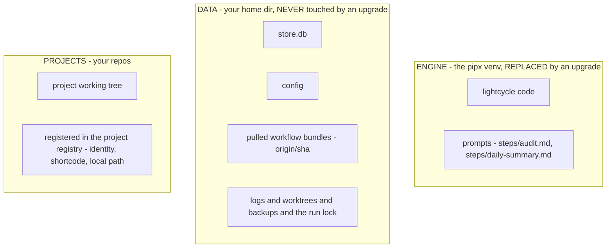

# Installation, config, and upgrades

## Install

```bash
pipx install git+https://github.com/kenmclennan/lightcycle
lc init                 # create the store, seed the home config, create + register the guidance repo (run once)
```

The engine runs on system `python3` with zero runtime dependencies, so `lc` works without any venv activation.

## The homes

lightcycle keeps code, data, and pulled workflows strictly apart. This split is what makes upgrades safe.



- **Engine** (`~/.local/pipx/venvs/lightcycle`) - the code plus `prompts/` (the engine-owned agent prompts it spawns directly: `prompts/steps/audit.md`, `prompts/steps/daily-summary.md`). This is the only thing an upgrade changes; the engine ships no workflow library.
- **Data** (`~/.lightcycle`, the `data_root`) - `store.db`, the `config` file, `logs/`, `.worktrees/` (isolated per-item checkouts), `backups/`, the `.lc-run.pid` singleton lock, `workflows/<origin>/<sha>/` (the immutable, sha-pinned workflow bundles pulled from origins), and `workflow-data/<origin>/<workflow>/` (each workflow's own data directory, kept across upgrades and `lc workflow rm`; `lc workflow purge` removes it).
- **Projects** - your repos, wherever they live. Each is named to lightcycle by registering it (`lc project add <owner/name> [--shortcode X] [--path P] [--facets a,b,c]`); the registry holds the identity, the shortcode ids are minted from, the local path, and the project's facets (`lc project scan` suggests facets for a repo from the guidance repo's `detected-by` lists; you set them yourself). A project carries no lightcycle config of its own, and there is no step or workflow override. `lc init` registers two projects automatically. The first has the identity `specs` (defaulting to `~/workspace/specs`) - the `workspace: specs` value a spec-driven workflow declares resolves through this same registry entry, not a dedicated config key. The second is the **guidance repo**, identity `guidance`, defaulting to `~/workspace/agent-guidance`; `lc init --guidance-path <dir>` overrides the path.

  If the guidance repo path does not exist, `lc init` creates it as a git repo with one commit holding index.md and CONVENTIONS.md; the CONVENTIONS.md is the engine's guidance conventions text and records its `Conventions version`. `lc guidance-check [--dir PATH] [--mode draft|final] [--base REF]` checks a guidance repo's changed entries against those conventions, reads only committed work (an uncommitted `.md` change fails, naming the file; with no changed entries it reports that no guidance files changed rather than clean), and `lc guidance-conventions` prints that text, version line included. A path that is already a git repo root is registered as-is, with its `origin` as the remote, and nothing is written into it - clone a team's shared guidance repo there before running `lc init`. A path that exists but is not a repo root (including a directory inside another repo) is refused, naming the path. A second `lc init` leaves the path alone but refreshes the stored remote of `guidance` and `specs` from their repo's `origin` when it differs (reporting `guidance: remote updated to <url>`); a path with no `origin`, or that is not a repo, keeps its stored remote. To re-point the path, run `lc project rm guidance` then `lc init [--guidance-path P]`. `lc guidance-dir` prints the registered path and `lc guidance-dir --check` verifies its `origin` matches the registered remote. lightcycle never creates a GitHub repository.

Workflows are not shadowed or resolved through a chain: each item pins one sha-pinned bundle (`<origin>/<name>@<sha>`) and the loader reads the flow and steps from that pin. `LC_HOME` names the data home (the store); the integration tests point it at a throwaway store. Never run against the live store by hand.

## Config

`~/.lightcycle/config` is the single boundary to the environment. Values are required and seeded visibly (no hidden defaults). Show or edit with `lc config [--edit]`.

A running pool (`lc start`) checks the file's modification time at the start of every tick. When it has moved, the pool re-reads the file, replaces its config and prints `config reloaded`, so `schedule-<id>` blocks, `schedules-paused`, `max-agents` and every other key apply within one tick. A reload only takes effect if the new file is valid: when it is missing, unreadable, or a required key is unset, blank or rejected by its getter, the pool keeps the last good config, writes one `warning: config reload rejected` line to stderr per distinct edit, and `lc doctor` reports it in the `config` category until the file changes again. Short-lived commands (`lc show`, `lc done`) read the file on each invocation.

Four keys are captured once when the pool starts and keep their start value until the pool is restarted: `poll-seconds`, `pool-upgrade-check-seconds`, `tick-failure-cap` and `spin-cap`. After an edit changes one, the tick line says `config reloaded - restart needed for: <keys>` and `lc doctor` reports it while that pool runs. Environment overrides are not re-read.

`lc config --edit` prints a notice, when the editor saved a change, that a running pool applies the edit within a tick except for those four keys, and that an open TUI keeps the old values until restarted. The TUI footer shows `↻ config changed - restart to apply` once the file's modification time moves past its value at launch.

This table documents every `_SEED_KEYS` entry - `tests/unit/test_docs_reference_real_things.py` fails the build if a key is added without a row here. The twelve `price-*-per-mtok` keys are documented as one row, keyed by the pattern `price-<model>-<kind>-per-mtok`, rather than individually.

| key | meaning |
| --- | --- |
| `projects` | root under which project repos live |
| `default-origin` | the workflow origin the spawner reads step prompts from. There is **no default workflow**: activation requires the item to carry `--workflow <origin>/<name>` |
| `workflows-remote` | git remote for the built-in workflow origin. Seeded blank; `lc init` only pulls it once set (`lc config --edit`, then `lc workflow add <url> --name <origin>`) |
| `workflow-retention` | pulled bundles kept per origin, minimum 1 (the current version and any a live item pins are always kept) |
| `max-agents` | worker cap the pool fills to each tick; must be `>= 0` (`0` pauses admission for the tick) |
| `poll-seconds` | pool tick interval |
| `github-poll-seconds` | how often the background github poll reads GitHub, minimum 1 and required (seeded `60`); separate from `poll-seconds` so a tick never waits on GitHub. Takes effect on the next config reload |
| `github-reserve-calls` | the github budget floor, required (seeded `750`, about an hour of the pool's own poll at one cycle a minute); while the **github budget** shows fewer `remaining` calls than this and the window has not reset, the pool neither spawns for nor claims a **github-heavy** step. `0` turns the hold off; must be `>= 0`; override with `LC_GITHUB_RESERVE_CALLS` |
| `github-view-refresh-polls` | every watched PR's view is re-read at least once per this many github polls, even when no trigger fired, minimum 1 and required (seeded `10`). Takes effect on the next config reload |
| `branch-prefix` | prefix for worktree branches |
| `max-boot-seconds` / `max-session-seconds` | worker boot and session caps; both must be `>= 0` |
| `stall-seconds` | how long a claimed worker's log can go without growing before the pool kills it and reclaims its step; must be `>= 0` |
| `ci-check-ceiling-seconds` | seeded at `3600`: how long a judged CI check may stay `in_progress` before `poll-ci` calls it timed out and routes `failed` naming it; override with `LC_CI_CHECK_CEILING_SECONDS`; must be `>= 1` |
| `probe-cooldown-seconds` | how long the breaker waits before allowing another probe after the previous one stalled; must be `>= 0` |
| `spin-cap` | consecutive no-work worker deaths, on one step or pool-wide, before the pool parks the step / caps itself to one worker |
| `backups-dir` / `backup-interval-minutes` / `backup-retention` | store snapshot location, cadence, and retention |
| `guidance-fetch-minutes` | how often the pool tick fetches the guidance repo's origin; delivery reads the default branch's fetched commit, never the working tree |
| `max-title-length` | cap on an item's title; `lc new`/`lc set` refuse a longer one outright rather than truncating, so detail belongs in `--description`. A step has no title of its own - it is composed at render time from its stage and its item's title - so this cap does not apply to one |
| `worktree-retries` / `worktree-retry-sleep` / `worker-history` / `editor` | pool + tooling knobs |
| `shutdown-grace-seconds` | how long `lc start`'s shutdown waits for killed workers to be reaped before sweeping; must be `>= 0` |
| `tick-failure-cap` | consecutive tick exceptions the pool loop tolerates (logging and continuing) before it re-raises and exits non-gracefully |
| `personal-origin` | the user's own workflow-origin repo, set by `lc workflow init`. Optional - unset (empty) until one exists |
| `context-artifact-types` | artifact types an agent step resolves to a repo-relative file path (e.g. `spec`). Required, seeded `spec`; a missing or blank value raises `ConfigError` |
| `context-artifact-project` | the registered project that `filepath`-kind artifacts resolve against and `lc specs-dir` syncs. Required, seeded `specs` |
| `audit-shortcode` | id prefix for items the engine creates for itself (seeded `AUD`), distinct from `shortcode`, which prefixes items you create. Forward-only: existing ids keep the prefix they were minted with. |
| `guidance-shortcode` | id prefix `lc init` registers the `guidance` project with, seeded `GDN`, env `LC_GUIDANCE_SHORTCODE`, so `--project guidance` mints `GDN-` ids. Forward-only, like `audit-shortcode`: `lc init` does not rewrite an already-registered `guidance` project (`lc doctor` reports `guidance-shortcode-missing` and its fix sets it) |
| `held-comment-shortcode` | id prefix for the items the engine files when it holds an untrusted PR comment for your decision, seeded `HLD`. Forward-only, like `audit-shortcode` |
| `trusted-authors` | space-separated GitHub logins, human or bot (trusting Copilot takes both `Copilot`, which authors its line comments, and `copilot-pull-request-reviewer[bot]`, which authors its reviews; a review bot can post under more than one login, so check the authors on its real comments), whose PR comments, reviews and `@lc` mentions may drive a workflow, compared case-insensitively. Required, no default; no bot is trusted by default: `lc init` seeds it from the `gh` identity when blank and never overwrites it. Until it is set the pool reads no PR comments. A comment from anyone else (a bot included, unless its login is in the key) is held as a `review-held-comment` step in `lc inbox` for `lc done <step> approve` or `reject`. Never set in a workflow bundle. A bundle that still declares the retired `review_bot_allowlist` hook loads, but the engine no longer reads it |
| `memory-reserve-fraction` | fraction of machine RAM the pool always withholds from worker admission, seeded at `0.65`: the memory gate refuses a new worker when the pool's memory share plus the largest worker's observed peak share would exceed `1 - memory-reserve-fraction`. The gate only withholds admission - it never suspends a worker - and it admits one worker whenever none is working. The value is a fraction of machine RAM, so it fires on smaller machines first; must be in `[0, 1]` |
| `guidance-budget-bytes` | cap on the bytes of guidance entry bodies delivered to one worker spawn, seeded at `6144`; an entry that does not fit is skipped whole, never truncated, and listed in the step's `guidance-skipped` record; must be `>= 0` |
| `guidance-unused-after-deliveries` | deliveries an entry needs with no citation before `lc guidance` flags it `unused`, seeded at `60`; override with `LC_GUIDANCE_UNUSED_AFTER_DELIVERIES`; must be `>= 1` |
| `lifecycle-timeout-seconds` | seeded at `300`: how long a workflow lifecycle hook (`install`, `upgrade`, `maintain`) may run before it is killed and counts as failed; must be at least `1` |
| `script-timeout-seconds` | seeded at `300`: how long a workflow script stage or script guard may run before it is killed and counts as a contract violation (the step parks, or the guard warns); must be at least `1` |
| `script-max-running` | seeded at `4`: how many workflow script stages may run at once; the rest wait for a later tick; must be at least `1` |
| `schedules-paused` | one switch that pauses every schedule, seeded at `false`: while `true` the pool tick evaluates no guard and files nothing, and a schedule due several times while paused fires at most once after the key goes back to `false`. An unreadable value pauses too. Never changes any schedule's `enabled` line |
| `schedule-<id>` | a block, one per schedule. A fresh config seeds four, `schedule-retro-audit`, `schedule-material-audit`, `schedule-daily-summary` and `schedule-ratchet-sweep` (workflow `lightcycle/ratchet-sweep`, Mondays 09:00, shortcode `AUD`, guard `repos-active`), enabled and filed under the `guidance` project; on an existing config nothing is added and `lc doctor` reports `schedule-not-enabled` for each retired job you have no block for. Indented `key: value` lines, edited by hand - `lc init` on an existing file, upgrade seeding and `lc doctor` never write or rewrite it. `enabled` (required, `true` or `false`; `false` records the schedule as off and it stays off), `workflow` (required, `<origin>/<name>`), `project` (required, a registered project with a shortcode), `cron` (five-field cron in local time: `*`, numbers, `a-b`, comma lists, `/n` steps; no names or macros), `guard` (`pending-reflections` with `min: <n>`, `materials-changed`, `day-unsummarised`, or `repos-active`), `shortcode` (default the project's), `labels` (space-separated). `cron` and `guard` fall back to the workflow bundle's `schedule:` suggestion field by field |
| `workflow-<origin>-<name>` | a block, one per workflow that reads config, never seeded: indented `key: value` lines edited by hand and reloaded live like `schedule-<id>`. The workflow's `config:` front matter declares which keys it reads and which are `required`; `lc doctor` flags a required key that is missing or blank, and two workflows whose names map to one block. Only declared keys reach a hook, as `LC_WORKFLOW_CONFIG_<KEY>` |
| `guidance-dormant-days` | days without a delivery before `lc guidance` flags a `stable` entry `never-delivered` (an entry never delivered flags only once it has existed that long), seeded at `60`; override with `LC_GUIDANCE_DORMANT_DAYS`; must be `>= 1` |
| `review-rounds-cap` | consecutive review-reject rounds on one step a workflow's review-rounds-cap transition tolerates before it fires |
| `tui-autostart-pool` | whether the TUI starts the pool loop automatically on launch |
| `tui-metrics` | whether the TUI records its own per-tick refresh timing to the run log |
| `developer-mode` | whether this machine develops lightcycle itself, so the engine and the plugin count as writable for routing a finding. Seeded `false`; override with `LC_DEVELOPER_MODE`. Nothing reads it yet beyond `lc config` |
| `tui-upgrade-check-seconds` | how often the TUI rechecks for a new engine version in the background; `0` disables the periodic recheck (the check still runs once on launch); must be `>= 0` |
| `pool-upgrade-check-seconds` | how often `lc start`'s pool loop rechecks for a new engine version while running; `0` disables the periodic recheck (the check still runs once at startup); must be `>= 0` |
| `price-<model>-<kind>-per-mtok` | per-million-token USD pricing used for usage cost reporting, one key per `<model>` (`sonnet`/`opus`/`haiku`) x `<kind>` (`input`/`output`/`cache-write`/`cache-read`) - twelve keys total, defaults in `config.py`'s `_SEED_KEYS`; each must be `>= 0` |

Example schedule block (kept in the config file, shown here for reference):

```yaml
schedule-weekly-audit:
  enabled: true
  workflow: lightcycle/material-audit
  project: lightcycle
  cron: 0 9 * * 1
  guard: materials-changed
  shortcode: AUD
  labels: audit weekly
```

`lc schedule list [--json]` shows every schedule, including bundle suggestions your config does not enable. `lc schedule run <id>` asks the running pool to fire an enabled `schedule-<id>` block on its next tick instead of waiting for the cron: the request is stored, so it survives a pool restart, and `lc schedule list` shows `run requested` until the pool takes it. The guard still decides: the request skips only the cron check, and it is used up once the guard has been evaluated, with the reason written to the pool's stderr when the guard does not pass. The command refuses, recording nothing, for an unknown id, a schedule that is not enabled, `schedules-paused` on, or a schedule with an open item.

## Workflow sources

Workflows come from pullable git **origins**, not the engine. `lc init` pulls the built-in `lightcycle` origin (from `workflows-remote`) into an immutable, sha-pinned bundle under `~/.lightcycle/workflows/<origin>/<sha>/`. Manage them with:

```bash
lc workflow init <name>       # scaffold + register a personal workflow-origin repo (registered writable)
lc workflow add <url> [--writable]  # register + pull an origin; read-only unless --writable
lc workflow set <origin> --writable|--read-only  # change whether you can edit an origin
lc workflow upgrade <origin> [--no-repin]  # pull the latest, re-pin in-flight items with a changed step ahead
lc workflow list              # origins, each marked writable or read-only, + on-disk bundle paths
lc workflow rm <origin>       # keeps the workflows' data directories
lc workflow purge <origin> [<workflow>]  # delete those data directories
```

Each item pins `<origin>/<name>@<sha>` at activation, and the loader resolves its flow and steps from that pin. When `lc workflow upgrade` moves an origin it repins each in-flight item of that origin that still has a changed step ahead of it, as `lc set <item> --workflow <origin>/<name>` would, printing one `repinned` line per item, a `held` line for any it could not repin, and a `left N` count of the rest; an item with nothing changed ahead keeps its pin and `lc doctor` does not report it. `--no-repin` keeps every item on its old pin, and `lc doctor` then reports each one that has a changed step ahead. A project customises its workflow by authoring its own source (see the `author-workflow` skill in the plugin), not by dropping override files anywhere. A project's `shortcode` is set when it is registered: `lc project add <owner/name> --shortcode X`. `lc project set <identity> --shortcode X` sets one on a project with none and refuses to change one whose prefix already has items, since ids are immutable.

## Upgrades

```bash
lc upgrade            # check remote version, upgrade in place if newer
lc upgrade --check    # report only, do not install
```

`lc upgrade` compares the installed `__version__` against the version on the repo's `main`, and if newer runs `UV_VENV_CLEAR=1 pipx install --force git+...` (the `UV_VENV_CLEAR=1` is required when pipx uses the `uv` backend, which otherwise refuses to overwrite the existing venv).

What an upgrade **changes**: the engine venv (code + `prompts/`). What it **does not touch**: `~/.lightcycle` - your store, config, logs, worktrees, pulled workflow bundles, and the project registry. Your data and pulled workflows survive every upgrade; workflows are updated separately with `lc workflow upgrade`.

Schema changes are handled separately: when a new engine opens a store it stamps a current store with its schema version, applies the additive column and cleanup migrations that remain, and opens it. It refuses a store written before the item/step split (one that still carries the `nodes` table) with a message naming the lightcycle release able to migrate it; migrate with that release first, then reopen. Migrations are idempotent. Stop the pool loop before upgrading, so the old engine is not running against a newly-migrated store; restart it after.

`lc doctor` reports what an upgrade left for you to bring up to date. Each of these findings carries a stable `kind` and a `fix` line (text and `lc doctor --json`), and is only reported, never fixed:

- `config-key-blank` - a required config key is set but blank, with what it does and how to set it.
- `config-key-obsolete` - a config key is set that this version no longer reads; the fix is to delete its line with `lc config --edit`.
- `guidance-conventions-outdated` - the guidance repo records an older conventions version than the engine ships; the update lands by PR.
- `schedule-not-enabled` - a workflow whose job the engine no longer runs itself has no `schedule-<id>` block in the config; the fix is to add one with `lc config --edit`, naming the workflow and one of your registered projects (`lc schedule list` shows the suggested cron and guard).
- `guidance-shortcode-missing` - the `guidance` project is registered without an id shortcode; the fix sets the configured `guidance-shortcode` with `lc project set`.
- `guidance-entries-nonconforming` - guidance entries on the default branch fail the current conventions; the fix is a `guidance-entry` backfill item.
- `guidance-entry-reverted` - an entry is `draft` on the default branch but was `stable` in its last 200 commits, so it stopped being delivered; the fix is a `guidance-entry` item to restore it to stable.
